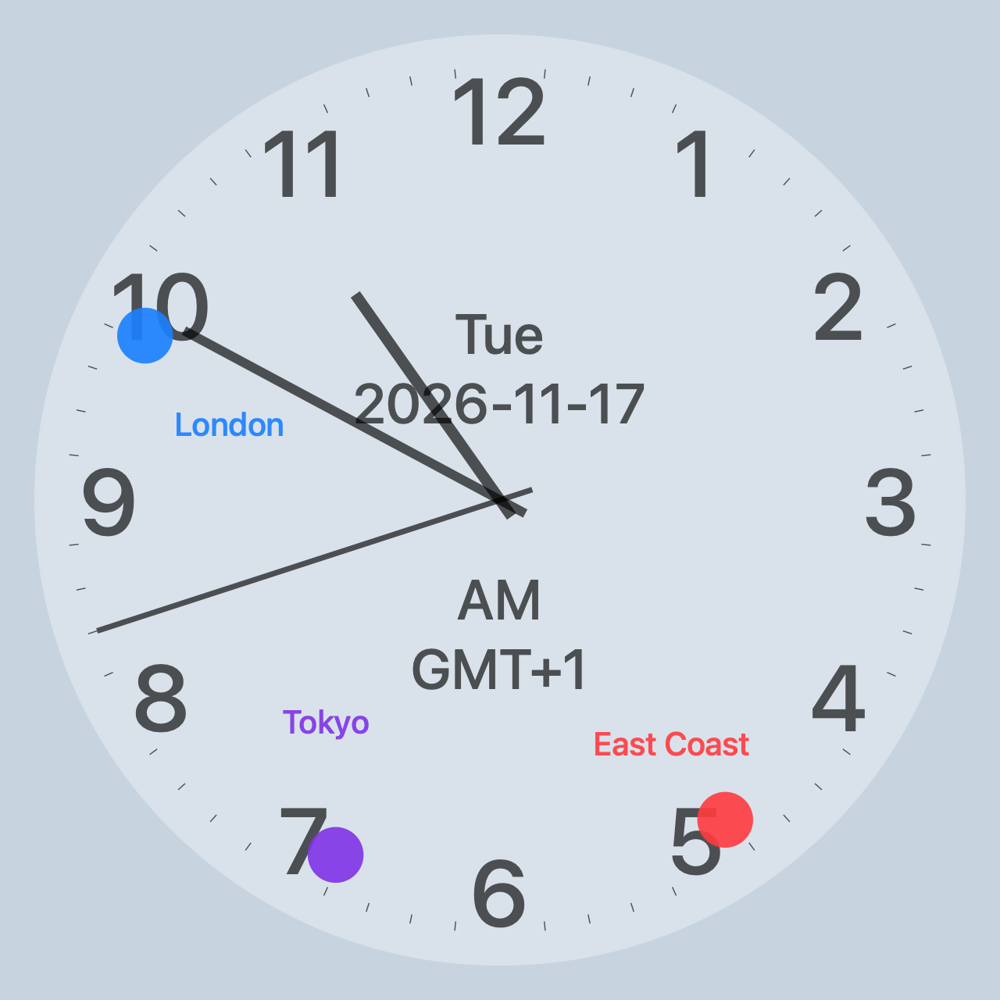

# Floating Clock

A small, native Apple Silicon replacement for SimpleFloatingClock: a translucent analogue clock that floats above your apps, with coloured time-zone dots for the cities or people you keep in touch with.



## Build and run

Requires an Apple Silicon Mac running macOS 13 or later and Xcode Command Line Tools (`xcode-select --install`). No third-party dependencies.

```sh
git clone https://github.com/catellie/floating-clock.git
cd floating-clock
bash build.sh
open "Floating Clock.app"
```

The build script runs the tests, compiles a native arm64 app, and signs it locally. Move the app to your Applications folder if you want to keep it there.

## Use

- Drag the clock to move it; right-click it or use its menu-bar icon for settings.
- Adjust size, face and hand opacity, light/dark appearance, and always-on-top or click-through behaviour.
- **Time-Zone Dots → Add Time-Zone Dot…** adds a marker with its own label, time zone, and colour. Select a dot's submenu to edit or remove it. Daylight saving changes are handled automatically.
- Position and settings are saved between launches.

To start automatically when you sign in, add the app under **System Settings → General → Login Items → Open at Login**.
